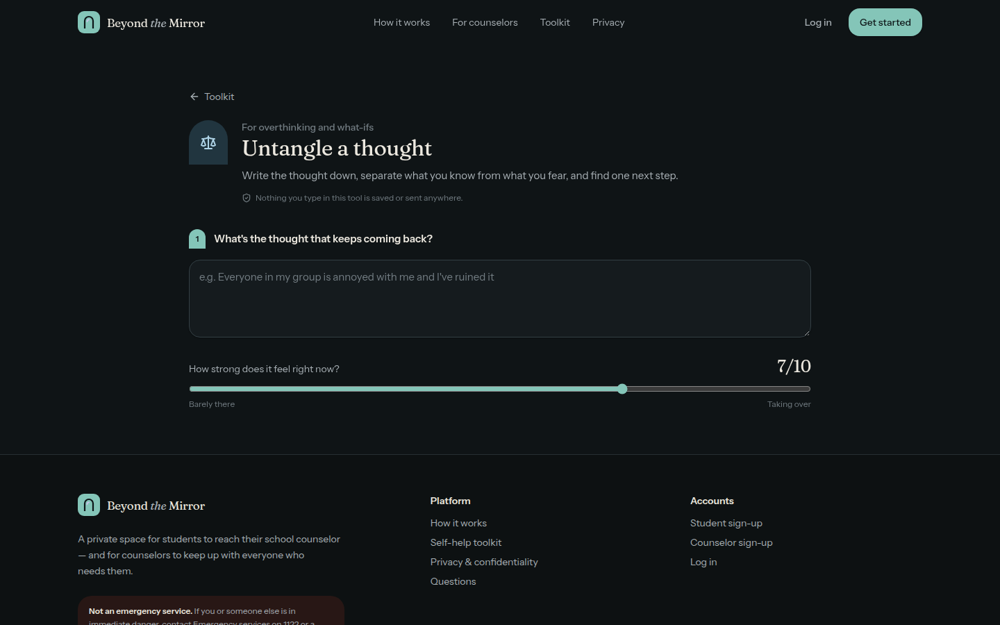

# Beyond the Mirror

**A private student–counselor support platform.** Students message their school counselor, track every request, book sessions and use a self-help toolkit. Counselors get a triaged inbox, private notes, scheduling and insights. Administrators manage accounts and caseloads — without ever seeing a single message.

Built with **Next.js 16 (App Router) · TypeScript · Tailwind CSS v4 · Supabase (Postgres, Auth, Realtime)** and deployable to **Vercel**.


| Student home | Counselor inbox |
| --- | --- |
|  |  |
| **Admin overview** | **Toolkit (dark mode)** |
|  |  |

---

## Features

**Students**
- Private, real-time conversations with their assigned counselor (topic, urgency, status, "Seen" receipts)
- Guided "new request" flow with draft saving and a safety prompt for urgent requests
- Request tracking: *Sent → Seen → Replied → Resolved*, resolve/reopen, and feedback
- Session booking from the counselor's open slots (in person / online / phone), cancellation, post-session rating
- Live notifications (bell + toasts) for replies, bookings and status changes
- Self-help toolkit (also public, no login): *Name the feeling, Untangle a thought, Bad-day reset, Exam stress kit (with revision planner), What should I say?, Friends/family/bullying guides, Letters you won't send*
- Optional WhatsApp hand-off if the counselor publishes a number

**Counselors**
- Two-pane inbox with live updates, search, filters (status, topic, urgency, unread) and sorting
- Status/urgency/topic controls, quick-reply templates, student side panel with history
- Private case notes (visible only to the author — not students, not admins)
- Availability management (one-off or weekly repeating slots) and booking management
- Overview dashboard: awaiting reply, urgent queue, median first-response time, ratings, topic breakdown
- Presence (Available / In a session / Away), profile, announcements

**Administrators**
- Approve or decline counselor sign-ups, change roles, pause/restore access
- Assign students to counselors (open requests move with them); auto-matching to lightest caseload
- Aggregate-only statistics: requests per day, by status and topic, caseloads, response times
- Announcements to everyone / students / staff

Also: light & dark themes, responsive layouts, accessible components (Radix), loading/empty/error states, and timezone-correct dates.

---

## Security model

Access control is enforced **in the database**, not just the UI. The browser only ever holds the Supabase publishable (anon) key.

- **Row Level Security on every table.** Students read only their own conversations; counselors only conversations assigned to them; admins have *no* policy that reaches messages, subjects, notes or feedback text.
- **Column-level grants.** Users can update only harmless profile fields — `role`, `status` and `counselor_id` are not writable by users. Role/assignment changes go through admin-only `SECURITY DEFINER` RPCs that re-check the caller.
- **Counselor accounts start `pending`** and have no access until an admin approves them. Sign-up metadata can't grant a role.
- **Server actions** re-verify the session and role, validate input with Zod, and call the database as the user (so RLS still applies).
- **Rate limits** on messages and new requests; length limits on all text fields; safe redirects; security headers.
- **No service-role key in the app.** It's only used by the optional local seed/test scripts.

`scripts/test-rls.mjs` contains **35 automated security tests** (cross-student reads, sender spoofing, privilege escalation, admin isolation, double booking, pending accounts, …).

---

## Getting started (local)

Requirements: Node 20+, Docker (for the local Supabase stack).

```bash
npm install
cp .env.example .env.local

npx supabase start          # starts Postgres/Auth/Realtime locally and applies migrations
npx supabase status         # copy API URL + publishable key (+ secret key for seeding) into .env.local

npm run seed                # optional: demo accounts and sample data
npm run dev                 # http://localhost:3000
```

Demo accounts after seeding (password `Mirror-demo-2026`):

| Role | Email |
| --- | --- |
| Student | `student@demo.school` (also `omar@`, `lina@`, `ethan@`) |
| Counselor | `counselor@demo.school`, `daniel@demo.school` |
| Admin | `admin@demo.school` |

Useful scripts:

| Script | What it does |
| --- | --- |
| `npm run dev` / `build` / `start` | Next.js |
| `npm run typecheck` | Route types + `tsc` |
| `npm run lint` | ESLint |
| `npm run db:reset` | Recreate the local DB from migrations |
| `npm run db:types` | Regenerate `src/lib/supabase/database.types.ts` |
| `npm run seed` | Demo data (local or a dev project) |
| `npm run test:rls` | Security tests — **local DB only** (run after `db:reset` + `seed`) |

---

## Deploying

### 1. Supabase

1. Create a project at [supabase.com](https://supabase.com).
2. Apply the schema — either:
   - `npx supabase link --project-ref <ref>` then `npx supabase db push`, **or**
   - paste `supabase/migrations/20261021000000_init.sql` into **SQL Editor → Run**.
3. **Authentication → URL Configuration**
   - *Site URL*: `https://your-app.vercel.app`
   - *Redirect URLs*: `https://your-app.vercel.app/**` (add preview URLs if you use them)
4. **Authentication → Providers → Email**: keep *Confirm email* on for production. Set minimum password length to 8.
5. *(Recommended)* **Authentication → Email Templates** — so links work even when opened on a different device, point them at the confirm route using the token hash:
   - Confirm signup: `{{ .SiteURL }}/auth/confirm?token_hash={{ .TokenHash }}&type=email`
   - Reset password: `{{ .SiteURL }}/auth/confirm?token_hash={{ .TokenHash }}&type=recovery&next=/reset-password`
6. Configure custom SMTP for real email volume (Supabase's built-in sender is rate-limited).

### 2. Vercel

1. Import the GitHub repository in Vercel (framework preset: **Next.js**).
2. Add environment variables (Production + Preview):

| Variable | Value |
| --- | --- |
| `NEXT_PUBLIC_SUPABASE_URL` | Project URL |
| `NEXT_PUBLIC_SUPABASE_PUBLISHABLE_KEY` | Publishable key (or use `NEXT_PUBLIC_SUPABASE_ANON_KEY`) |
| `NEXT_PUBLIC_SITE_URL` | `https://your-app.vercel.app` |
| `NEXT_PUBLIC_DEFAULT_TIMEZONE` | e.g. `Asia/Karachi` — used until the browser reports its own |
| `NEXT_PUBLIC_CRISIS_LINE_NAME` / `_NUMBER` | Your local emergency line, shown in safety notices |

Do **not** add `SUPABASE_SECRET_KEY` to Vercel — the app doesn't need it.

3. Deploy.

### 3. Create the first administrator

Register normally on the deployed site, then run in the Supabase SQL editor:

```sql
update public.profiles set role = 'admin', status = 'active'
where email = 'you@your-school.edu';
```

From then on, approve counselors and assign students from **Admin → People / Assignments**.

---

## Project structure

```
supabase/migrations/       Schema, RLS policies, grants, triggers, RPCs, realtime publication
scripts/                   seed.mjs (demo data), test-rls.mjs (security tests)
src/proxy.ts               Session refresh + optimistic auth redirect (Next 16 "proxy")
src/actions/               Server actions — validated, role-checked mutations
src/lib/                   auth (DAL), supabase clients, validation, constants, time/tz, queries
src/hooks/                 realtime subscriptions, form helpers
src/components/ui/         Design-system primitives (button, input, dialog, badge, …)
src/components/shared/     Chat thread, status badges, counselor card, stats
src/components/toolkit/    The seven self-help tools
src/app/(marketing)/       Landing page + public toolkit
src/app/(auth)/            Login, register, password reset
src/app/student|counselor|admin/   Role-based portals
```

See [`docs/PRODUCT.md`](docs/PRODUCT.md) for the product analysis, user journeys and design system.

---

## Important notes

- **Not an emergency service.** The UI says so throughout. Configure `NEXT_PUBLIC_CRISIS_LINE_*` for your region, and agree a safeguarding process with your counseling team before launch.
- Review your local data-protection requirements (e.g. parental consent, retention) before using with real students.
