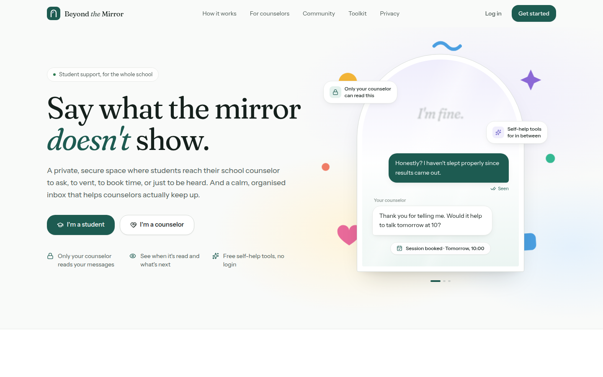
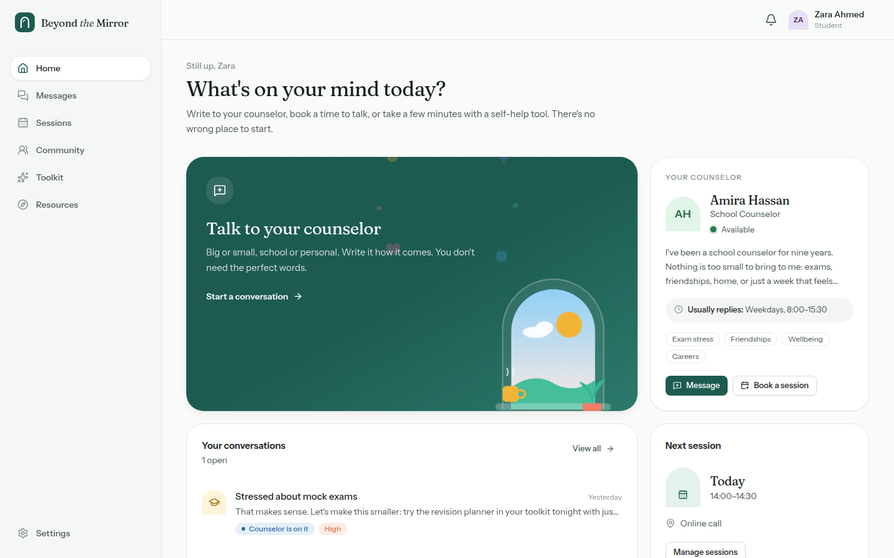
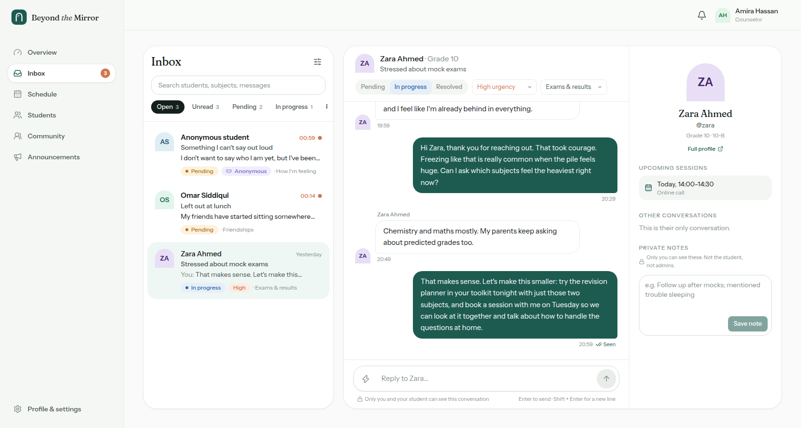
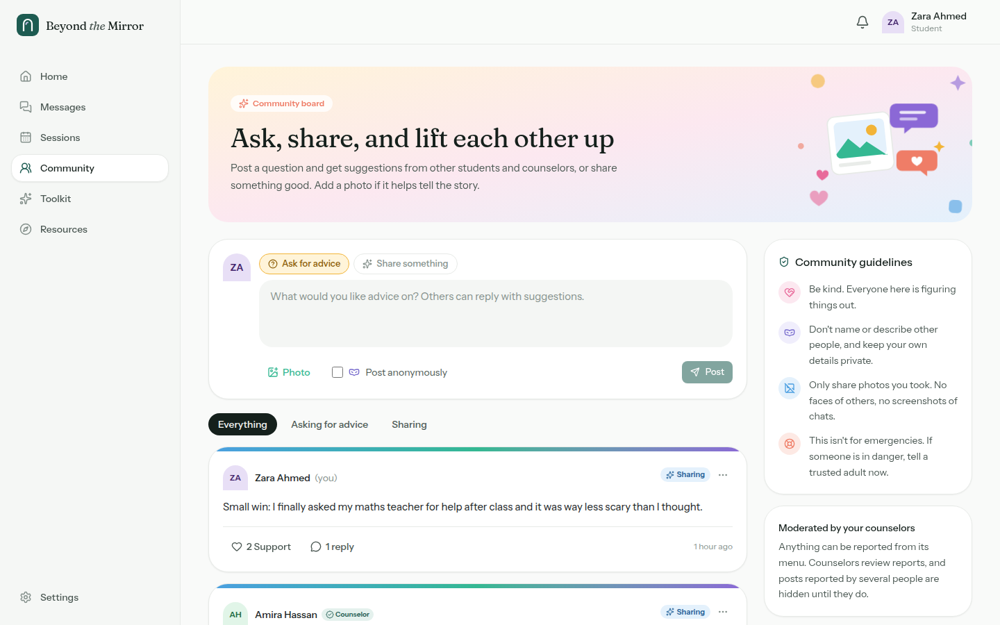
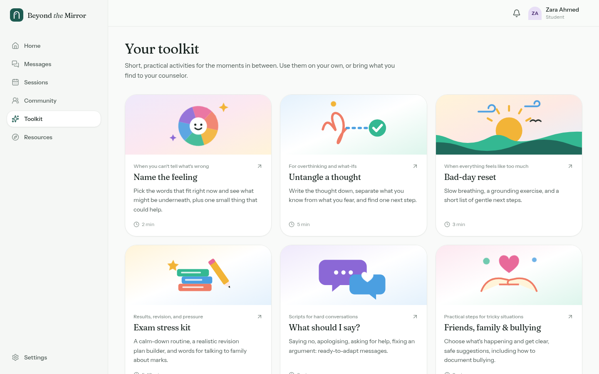
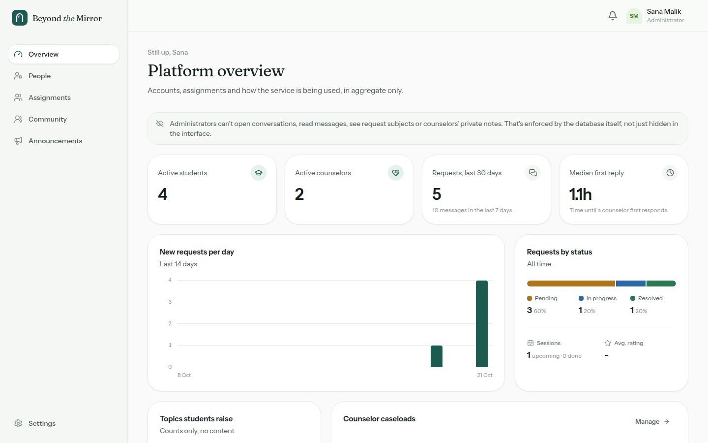
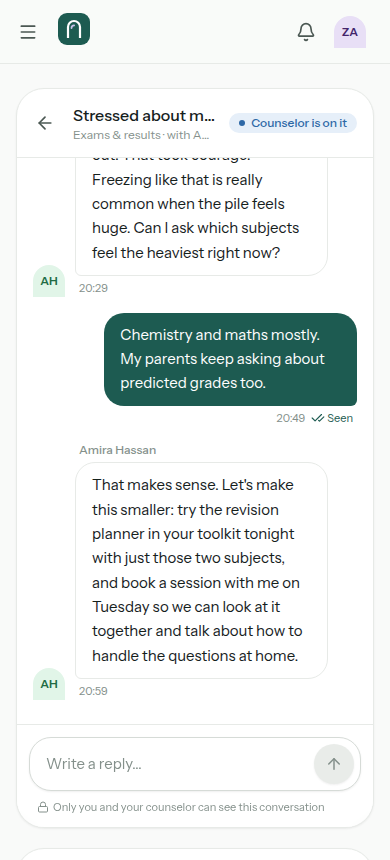

# Beyond the Mirror

**A private student–counselor support platform.** Students message their school counselor, track every request, book sessions and use a self-help toolkit. Counselors get a triaged inbox, private notes, scheduling and insights. Administrators manage accounts and caseloads without ever seeing a single message.

Built with **Next.js 16 (App Router) · TypeScript · Tailwind CSS v4 · Supabase (Postgres, Auth, Realtime)** and deployable to **Vercel**.



| Student home | Counselor inbox |
| --- | --- |
|  |  |
| **Community board** | **Self-help toolkit** |
|  |  |
| **Admin overview** | **Phone** |
|  |  |

---

## Features

**Accounts:** no email needed. Students and counselors sign up with a **username, password and a few profile details** (name, year, class, student ID; contact email is optional). There's one **built-in administrator login** (overridable with environment variables), so there's no admin sign-up and no SQL step.

**Students**
- Private, real-time conversations with their assigned counselor (topic, urgency, status, "Seen" receipts)
- **Anonymous messages:** a student can write to their counselor without revealing who they are, and share their name later if they choose. Anonymity is enforced in the database: the counselor's data never contains the student's identity
- **Community board:** posts asking for advice or sharing something, with an optional photo, replies, "Support" reactions, reporting and counselor moderation. Students can post anonymously (hidden from other students; staff can see who posted, for safeguarding)
- Guided "new request" flow with draft saving and a safety prompt for urgent requests
- Request tracking: *Sent → Seen → Replied → Resolved*, resolve/reopen, and feedback
- Session booking from the counselor's open slots (in person / online / phone), cancellation, post-session rating
- Live notifications (bell + toasts) for replies, bookings and status changes
- Self-help toolkit (also public, no login): *Name the feeling, Untangle a thought, Bad-day reset, Exam stress kit (with revision planner), What should I say?, Friends/family/bullying guides, Letters you won't send*
- Optional WhatsApp hand-off if the counselor publishes a number

**Counselors**
- Two-pane inbox with live updates, search, filters (status, topic, urgency, unread) and sorting
- Status/urgency/topic controls, quick-reply templates, student side panel with history
- Private case notes (visible only to the author, not students or admins)
- Availability management (one-off or weekly repeating slots) and booking management
- Overview dashboard: awaiting reply, urgent queue, median first-response time, ratings, topic breakdown
- Presence (Available / In a session / Away), profile, announcements
- Community moderation: hide or delete posts and replies, see report counts

**Administrators**
- Approve or decline counselor sign-ups, change roles, pause/restore access
- Reset a student's or counselor's password (shows a one-time temporary password, since accounts have no email)
- Assign students to counselors (open requests move with them); auto-matching to lightest caseload
- Aggregate-only statistics: requests per day, by status and topic, caseloads, response times
- Announcements to everyone / students / staff

Also: a clean white theme, responsive layouts from phone to desktop, accessible components (Radix), loading/empty/error states, and timezone-correct dates.

---

## Security model

Access control is enforced **in the database**, not just the UI. The browser only ever holds the Supabase publishable (anon) key.

- **Row Level Security on every table.** Students read only their own conversations; counselors only conversations assigned to them; admins have *no* policy that reaches messages, subjects, notes or feedback text.
- **Column-level grants.** Users can update only harmless profile fields. `role`, `status` and `counselor_id` are not writable by users. Role/assignment changes go through admin-only `SECURITY DEFINER` RPCs that re-check the caller.
- **Counselor accounts start `pending`** and have no access until an admin approves them. Sign-up details can't grant a role.
- **Username accounts.** Supabase Auth needs an email-shaped identifier, so each username maps to an internal address on the reserved `.invalid` domain. Nothing is ever emailed. Reserved usernames (`admin`, `support`, …) are blocked in the database itself.
- **Built-in admin.** The admin password is stored only as a salted scrypt hash (or taken from `ADMIN_PASSWORD` if set) and checked in constant time. On first login the server creates the admin account using a one-time token that only the server can mint, so nobody can claim the admin role through the public auth API.
- **Server actions** re-verify the session and role, validate input with Zod, and call the database as the user (so RLS still applies).
- **Anonymity by design.** Anonymous conversations store the owner in a private table the API can't reach; the conversation has no student, and the student's messages have no sender. Feedback on them can't be traced either.
- **Community data is never exposed directly.** Posts, replies and reactions are only readable through functions that mask anonymous authors. Photos go to a private storage bucket after the server checks the real file type, and are shown through short-lived signed links. The browser re-draws each photo before upload, which shrinks it and strips hidden metadata such as GPS location.
- **Brute-force protection.** After 8 failed logins for a username (or 40 from one IP) in 15 minutes, logins are blocked for that window. Sign-ups are limited per IP. Attempts are stored in a table only the server can access.
- **Rate limits** on messages and new requests; length limits on all text fields; safe redirects.
- **Security headers:** a strict Content-Security-Policy (scripts only from this site; network only to your Supabase project), `X-Frame-Options: DENY`, `nosniff`, a strict referrer policy and a locked-down permissions policy.
- **The Supabase secret (service-role) key stays on the server.** It's used only to create accounts, prepare the admin login and reset passwords, never to read conversations, and never sent to the browser.

`scripts/test-rls.mjs` contains **56 automated security tests** (cross-student reads, sender spoofing, privilege escalation, admin isolation, anonymity, community masking and moderation, reserved usernames, double booking, pending accounts, …).

---

## Getting started (local)

Requirements: Node 20+, Docker (for the local Supabase stack).

```bash
npm install
cp .env.example .env.local

npx supabase start          # starts Postgres/Auth/Realtime locally and applies migrations
npx supabase status         # copy API URL, publishable key and secret key into .env.local


npm run seed                # optional: demo accounts and sample data
npm run dev                 # http://localhost:3000
```

Demo accounts after seeding (usernames; password `Mirror-demo-2026`):

| Role | Username |
| --- | --- |
| Student | `zara`, `omar`, `lina`, `ethan` |
| Counselor | `amira`, `daniel` |
| Admin | the built-in admin login |

Useful scripts:

| Script | What it does |
| --- | --- |
| `npm run dev` / `build` / `start` | Next.js |
| `npm run typecheck` | Route types + `tsc` |
| `npm run lint` | ESLint |
| `npm run db:reset` | Recreate the local DB from migrations |
| `npm run db:migrate` | Apply pending migrations to the database in `DATABASE_URL` |
| `npm run db:types` | Regenerate `src/lib/supabase/database.types.ts` |
| `npm run seed` | Demo data (local or a dev project) |
| `npm run test:rls` | Security tests, **local DB only** (run after `db:reset` + `seed`, with `ADMIN_PASSWORD` set to the admin password) |

---

## Deploying to Vercel

Until a database is connected, the site still works: the landing page and toolkit load, and the login page shows a "we're almost ready" notice.

### 1. Connect a Supabase database (one click)

In Vercel, open your project → **Storage** → **Create / Connect Database** → **Supabase** → connect it to this project for **Production and Preview** (leave the environment-variable prefix empty).

This adds the database variables automatically (`NEXT_PUBLIC_SUPABASE_URL`, `NEXT_PUBLIC_SUPABASE_ANON_KEY`, `SUPABASE_SERVICE_ROLE_KEY`, `POSTGRES_URL_NON_POOLING`, …). The tables are created automatically: during the build, or, if the build can't reach the database, on the first visit to the login page. Database problems never fail a deploy.

> **Using an existing Supabase project instead?** Add `NEXT_PUBLIC_SUPABASE_URL`, `NEXT_PUBLIC_SUPABASE_PUBLISHABLE_KEY` and `SUPABASE_SECRET_KEY` yourself (Supabase → Project Settings → API). Then either add `DATABASE_URL` (Settings → Database → connection string) so builds apply migrations, or run both files in `supabase/migrations/` in order in the SQL Editor.

### 2. Optional environment variables

Vercel → Settings → **Environment Variables**:

| Variable | Value |
| --- | --- |
| `ADMIN_USERNAME` / `ADMIN_PASSWORD` | Optional: override the built-in admin login |
| `ADMIN_DISPLAY_NAME` | Optional, e.g. `Ms. Sana Malik` |
| `NEXT_PUBLIC_SITE_URL` | `https://your-app.vercel.app` |
| `NEXT_PUBLIC_DEFAULT_TIMEZONE` | e.g. `Asia/Karachi` |
| `NEXT_PUBLIC_CRISIS_LINE_NAME` / `_NUMBER` | Your local emergency line, shown in safety notices |

Then **Deployments → ⋯ → Redeploy**.

### 3. Recommended Supabase settings

- **Authentication → Sign In / Providers → "Allow new users to sign up": OFF.** The app creates accounts itself through the server, so the public sign-up endpoint isn't needed. Turning it off closes it to scripts.
- **Authentication → Rate limits:** keep the defaults or tighten them.

### 4. Log in as admin

Go to `/login` and use the admin login. The admin account is created on first login. To change it later, set `ADMIN_USERNAME` / `ADMIN_PASSWORD` in Vercel and redeploy.

### Troubleshooting

- **"We're almost ready"** on the login page → the box under it says exactly what's missing (database not connected, server key missing, or tables not created). Supabase variables are read at build time, so **redeploy after connecting**.
- **Tables not created** → check the build log and the function logs for `[migrate]` lines, or run the files in `supabase/migrations/` in order in Supabase's SQL Editor.
- **Admin login says the account couldn't be prepared** → a non-admin account already uses that username. Pick a different `ADMIN_USERNAME`.

---

## Project structure

```
supabase/migrations/       Schema, RLS policies, grants, triggers, RPCs, realtime publication
scripts/                   migrate.mjs (build-time migrations), seed.mjs (demo data), test-rls.mjs (security tests)
src/proxy.ts               Session refresh + optimistic auth redirect (Next 16 "proxy")
src/actions/               Server actions: validated, role-checked mutations
src/lib/                   auth (DAL), supabase clients, validation, constants, time/tz, queries
src/hooks/                 realtime subscriptions, form helpers
src/components/ui/         Design-system primitives (button, input, dialog, badge, …)
src/components/shared/     Chat thread, status badges, counselor card, stats
src/components/toolkit/    The seven self-help tools
src/app/(marketing)/       Landing page + public toolkit
src/app/(auth)/            Login, register, password reset
src/app/student|counselor|admin/   Role-based portals
```

See [`docs/PRODUCT.md`](docs/PRODUCT.md) for the product analysis, user journeys and design system.

---

## Important notes

- **Not an emergency service.** The UI says so throughout. Configure `NEXT_PUBLIC_CRISIS_LINE_*` for your region, and agree a safeguarding process with your counseling team before launch.
- Review your local data-protection requirements (e.g. parental consent, retention) before using with real students.
